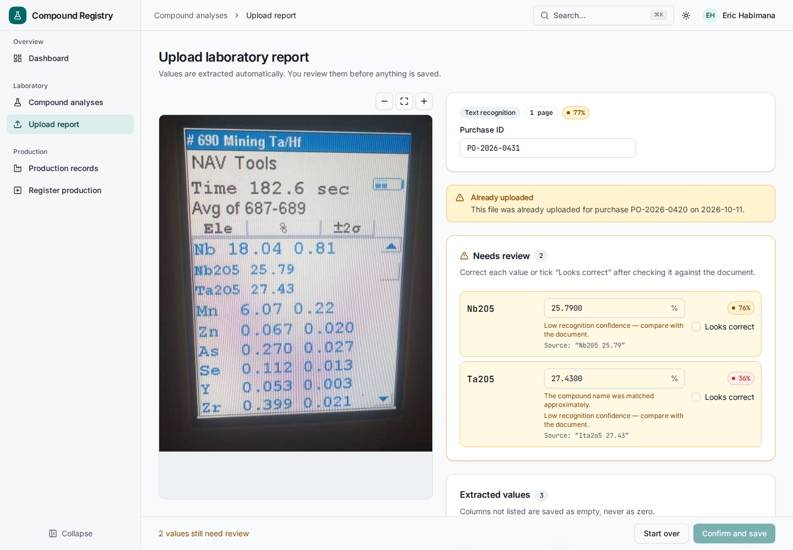
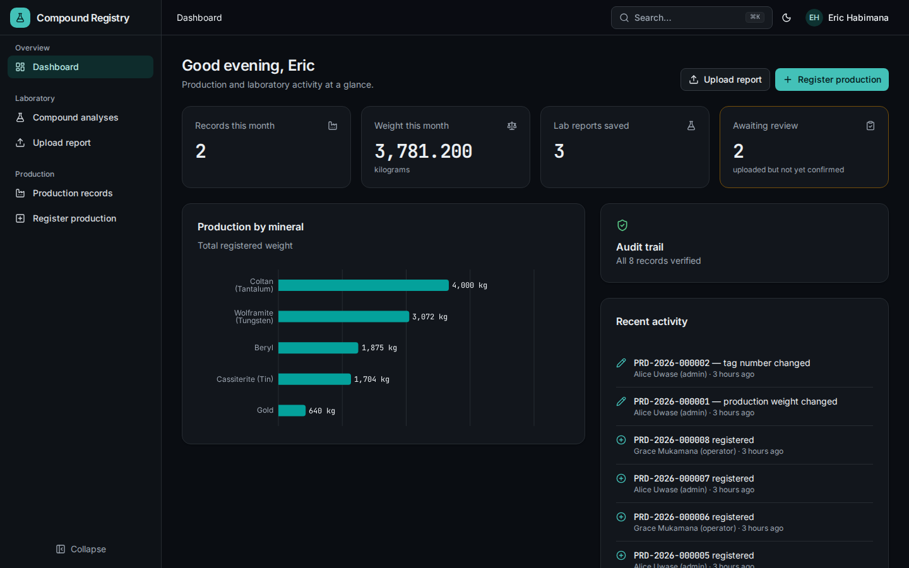
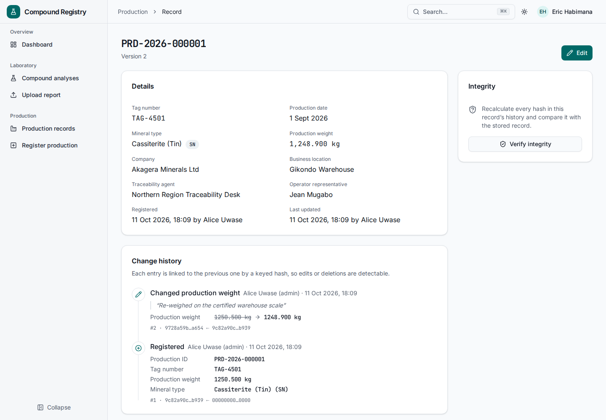
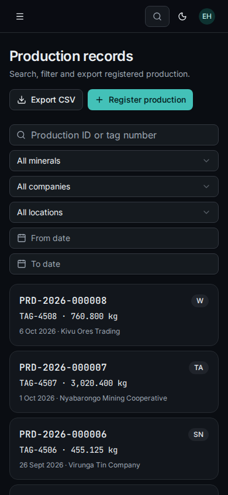

# Compound Registry

A web application for mineral traceability teams. It does two jobs:

1. **Compound analysis** — upload a laboratory report (PDF, JPG, JPEG or PNG; text-based, scanned or a phone photo), extract the compound percentages automatically, review them beside the original document, and save the verified values into the `Compound` table.
2. **Production registration** — register production batches, search and export them, and keep a tamper-evident history of every change to the production ID, tag number, weight and mineral type.



| Dashboard (dark)                                  | Production record with its verified history                  | Phone                                                 |
| ------------------------------------------------- | ------------------------------------------------------------ | ----------------------------------------------------- |
|  |  |  |

## Quick start

Requirements: Docker with Compose v2.

```bash
cp .env.example .env
# set two random secrets
sed -i "s/^JWT_SECRET=.*/JWT_SECRET=$(openssl rand -hex 32)/; s/^AUDIT_SECRET=.*/AUDIT_SECRET=$(openssl rand -hex 32)/" .env
docker compose up --build -d
```

Open <http://localhost:8080>. The API documentation is at <http://localhost:8080/docs>.

Demo accounts (password `Demo!2026`):

| Email                    | Role          | Can                                                                                        |
| ------------------------ | ------------- | ------------------------------------------------------------------------------------------ |
| `admin@example.com`      | Administrator | Everything, including changing a production ID and managing reference data through the API |
| `supervisor@example.com` | Supervisor    | Upload reports, register and correct production, view and verify history                   |
| `operator@example.com`   | Operator      | Upload reports, register production, edit non-critical fields of own records               |
| `auditor@example.com`    | Auditor       | Read everything, download reports, view and verify history                                 |

To run without Docker, see [docs/DEPLOYMENT.md](docs/DEPLOYMENT.md#local-development).

## What is included

**Compound analysis**

- Upload form with purchase ID, drag-and-drop, type and size checks in the browser and on the server, upload progress and processing stages.
- Extraction from selectable PDF text, scanned PDFs and photos, with OCR when needed.
- Review screen: the document beside the extracted values, a confidence score per value, uncertain values pinned for review, values the report marks as not measured kept empty, values without a matching column listed separately. Nothing is stored until the reviewer confirms.
- Saved analyses with search by purchase ID and date, and access to the original file.

**Production registration**

- Registration form with searchable lists loaded from the server, a date picker that blocks future dates, weight validation and protection against double submission.
- Search, filters, sorting, pagination and CSV export.
- Role-based editing: changes to the tag number, weight, mineral type or production ID require a reason and are added to the history; simultaneous edits are detected.
- History timeline and a one-click integrity check per record; the dashboard checks every record.

**Platform**

- Cookie sessions with refresh-token rotation, CSRF protection, login rate limiting and four roles enforced on the server.
- Migrations that keep the provided `Compound` table and its data (see [Notes on the provided schema](#notes-on-the-provided-schema)).
- Unit, integration and end-to-end tests; API reference; deployment guide; Docker Compose; CI workflow.

## How extraction works

1. **Intake** — the file type is detected from its content; the name must agree. Files are stored outside any public folder under random names.
2. **Text** — PDFs are read with poppler. The embedded text layer is used only if it is clean: scanners often embed garbled text (for example `Si02雪11.32`), which is scored and rejected.
3. **OCR** — scanned pages and images are rendered at 300 DPI, converted to normalised greyscale and read with Tesseract (English and French) in two layout modes. When the result is weak — a photo of a screen, for example — four alternative preparations are added and the readings are combined by confidence-weighted vote.
4. **Normalisation** — subscripts (`Nb₂O₅`), zero/letter-O mix-ups inside formulas (`U308` → `U3O8`) and decimal commas (`0,067`) are corrected.
5. **Matching** — every `Compound` column has a list of spellings. Elements and oxides are kept apart: `Zn` fills `zn_percent`, never `zno_percent`; elements with no column of their own (`Nb`, `Y`, `Zr`, `Se`) are reported, not forced into an oxide column. Weights, dates, phone numbers and certificate numbers are ignored.
6. **Scoring** — each value gets a confidence from OCR certainty, name match and plausibility (0–100 %, at most 4 decimals). Integers next to element symbols — typically atomic numbers on laboratory seals — are always flagged.

The four sample reports supplied with the assignment are test fixtures; each one has an expected-values file and is checked column by column.

| Sample                                        | What makes it hard                                                                           |
| --------------------------------------------- | -------------------------------------------------------------------------------------------- |
| Scanned assay certificate (PDF)               | Garbled embedded text, zero/letter-O confusion, decimal commas, 23 values                    |
| Analysis report printed to PDF                | Image only, yellow watermark across the value                                                |
| Certificate exported from a spreadsheet (PDF) | French table layout, subscripts, `/` meaning "not measured", sample weight beside the values |
| Photo of a handheld XRF screen (JPG)          | Low resolution, screen moiré, a second number per line that is the measurement uncertainty   |

## How the audit trail works

Every change to the production ID, tag number, weight or mineral type appends an event to `production_audit_event` in the same database transaction as the change. Each event stores the previous and new values, the reason, who made the change and when, the previous event's hash and its own hash:

```
hash = HMAC-SHA256(AUDIT_SECRET, canonical JSON of the event including prev_hash)
```

Database triggers reject updates and deletions on the event table. Verification reads the record and its events from one consistent snapshot, recomputes the chain and checks that the sequence has no gaps, that each event links to the one before it, that every hash matches, and that replaying the history reproduces the current record. This detects edited events, deleted events in the middle of a history, deletion of the latest event when the record keeps its current values, records changed directly in the database and chains rebuilt without the secret. The integration tests tamper with the database in each of these ways and assert that verification fails.

**Limits.** Someone with full database access who also removes the triggers can delete a record's most recent events _and_ roll the record back to the values before them, or delete a record together with its whole history; nothing left in the database contradicts that. Detecting it needs a copy of the chain heads kept outside the database (for example, a daily signed export or a public timestamp), which the data model supports but this version does not include.

## Project structure

```
apps/api            Fastify API: auth, compounds (extraction pipeline), production, audit, reference data, dashboard
apps/web            React application: dashboard, upload and review, analyses, production registry
packages/contracts  Validation schemas, compound catalogue, permissions and error codes shared by both apps
e2e                 Browser tests across the whole stack
docker              Container images and web server configuration
docs                API reference, deployment guide, system design
```

## Testing

| Command                 | Covers                                                                                                                               |
| ----------------------- | ------------------------------------------------------------------------------------------------------------------------------------ |
| `pnpm test`             | Unit tests: shared schemas, extraction (including the four real reports), hash chain, CSV, web logic                                 |
| `pnpm test:integration` | Every API endpoint against MySQL: permissions, validation, transactions, idempotency, concurrent edits, time zones, tamper detection |
| `pnpm test:e2e`         | Browser tests: upload → review → save, registration → correction → verification → tamper detection, read-only auditor, phone layout  |

Integration and end-to-end tests need a running MySQL and Tesseract; see the [deployment guide](docs/DEPLOYMENT.md#local-development).

## Documentation

- [Requirements coverage](docs/REQUIREMENTS.md) — every requirement of the brief, where it is implemented and how it is tested
- [API reference](docs/API.md) — conventions, error codes and examples; interactive version at `/docs`
- [Deployment guide](docs/DEPLOYMENT.md) — configuration, environment variables, production checklist
- [System design](docs/design/2026-10-11-system-design.md) — requirements analysis, data model and decisions

## Design decisions

- **OCR runs locally.** Laboratory results stay on the server and no external account is needed. Accuracy limits are handled by the review step rather than hidden.
- **A keyed hash chain instead of a public blockchain.** It gives the tamper evidence the requirement asks for, runs anywhere MySQL runs and costs nothing per change. The latest hash can be anchored externally later without changing the data model.
- **Extraction happens within the upload request.** A one-page report takes seconds; a job queue would add moving parts without improving the experience.
- **Decimals are strings end to end.** Percentages and weights never pass through floating-point numbers, so `63.63` is stored as `63.6300`, not `63.629999`.

## Notes on the provided schema

The supplied `Compound.sql` does not run as given and is adjusted by migrations, never edited in place:

- The trailing comma before `);` is removed.
- `id` becomes `AUTO_INCREMENT` (it was a primary key without a generator) and `purchase_id` gets an index.
- Every column is kept. Columns whose meaning is unclear — `ai2o3_percent` (likely a misspelling of `al2o3_percent`, which also exists), `hso2_percent`, `ph_percent`, `bal_percent`, `i_percent` — are never filled automatically; a reviewer can still enter them.
