# User guide

This guide is for the people who use Compound Registry every day: laboratory and traceability staff, supervisors, auditors and administrators. For installation see the [deployment guide](DEPLOYMENT.md); for the HTTP interface see the [API reference](API.md).

## Contents

1. [Signing in](#signing-in)
2. [Roles: who can do what](#roles-who-can-do-what)
3. [Finding your way around](#finding-your-way-around)
4. [Uploading and reviewing a laboratory report](#uploading-and-reviewing-a-laboratory-report)
5. [Finding saved analyses](#finding-saved-analyses)
6. [Registering production](#registering-production)
7. [Correcting a production record](#correcting-a-production-record)
8. [Checking a record's history](#checking-a-records-history)
9. [Searching and exporting production records](#searching-and-exporting-production-records)
10. [Administration](#administration)
11. [Settings, language and theme](#settings-language-and-theme)
12. [Using a phone or tablet](#using-a-phone-or-tablet)
13. [Troubleshooting](#troubleshooting)

## Signing in

Open the address your administrator gave you (for a local installation, <http://localhost:8080>) and sign in with your email and password.

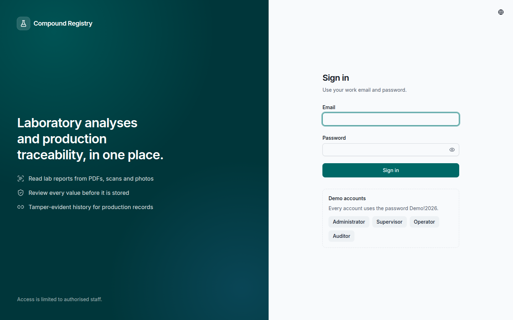

- If you were given a **temporary password**, you are asked to choose a new one straight away. Use at least 12 characters.
- After several wrong attempts, sign-in is paused for a short time. Wait a minute and try again.
- Your session stays open while you work and ends after a week without use. Select **Sign out** from the account menu (top right) when you share a computer.

On your first sign-in a short **guided tour** shows the main places. Press **Next** to follow it or **Escape** to skip it. You can replay it at any time from the help panel.

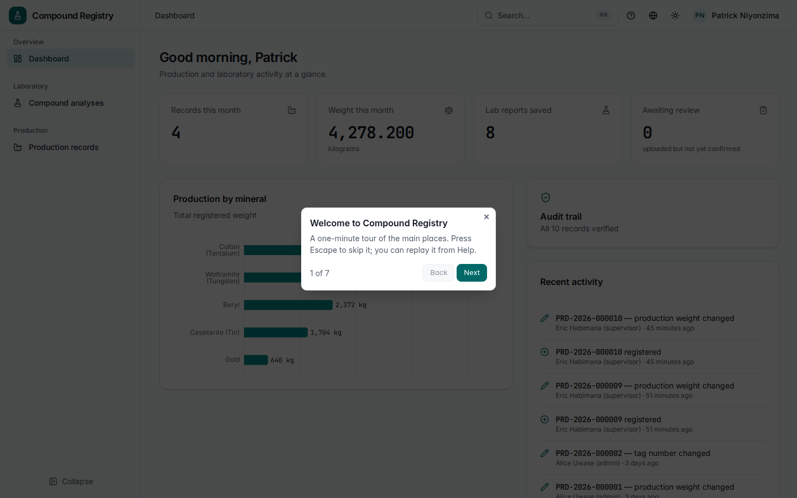

## Roles: who can do what

Your role is set by an administrator. The menu only shows what your role allows; a page opened by its address that your role cannot use explains this instead of showing the form.

| Task                                                  | Operator      | Supervisor | Auditor | Administrator |
| ----------------------------------------------------- | ------------- | ---------- | ------- | ------------- |
| Upload a report and save its values                   | Yes           | Yes        | —       | Yes           |
| View analyses and download the original report        | Yes           | Yes        | Yes     | Yes           |
| Register production                                   | Yes           | Yes        | —       | Yes           |
| Edit non-critical fields of a production record       | Own records   | Yes        | —       | Yes           |
| Correct the tag number, weight or mineral type        | —             | Yes        | —       | Yes           |
| Change a production ID                                | —             | —          | —       | Yes           |
| View a record's history and verify its integrity      | —             | Yes        | Yes     | Yes           |
| Manage users, reference data and read the activity log | —            | —          | —       | Yes           |

## Finding your way around

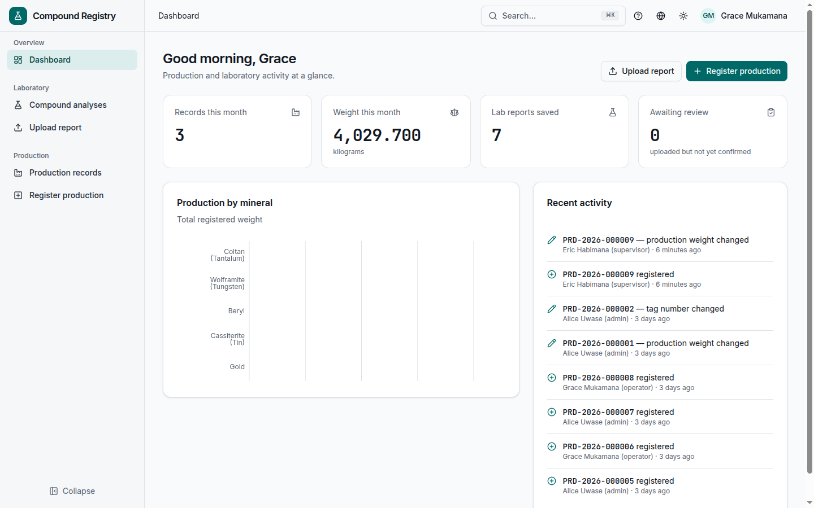

- **Dashboard** — production this month, recent analyses and the result of the latest integrity check across all records. A warning appears here if any record's history fails verification.
- **Sidebar** — every section you have access to. Collapse it with the arrow at the bottom to gain space.
- **Search** (top bar, or **Ctrl K**) — jump to a page or open a production record by its ID or tag number.
- **Help** (the **?** button, or press **?**) — searchable how-to articles, keyboard shortcuts and your administrator's contact.

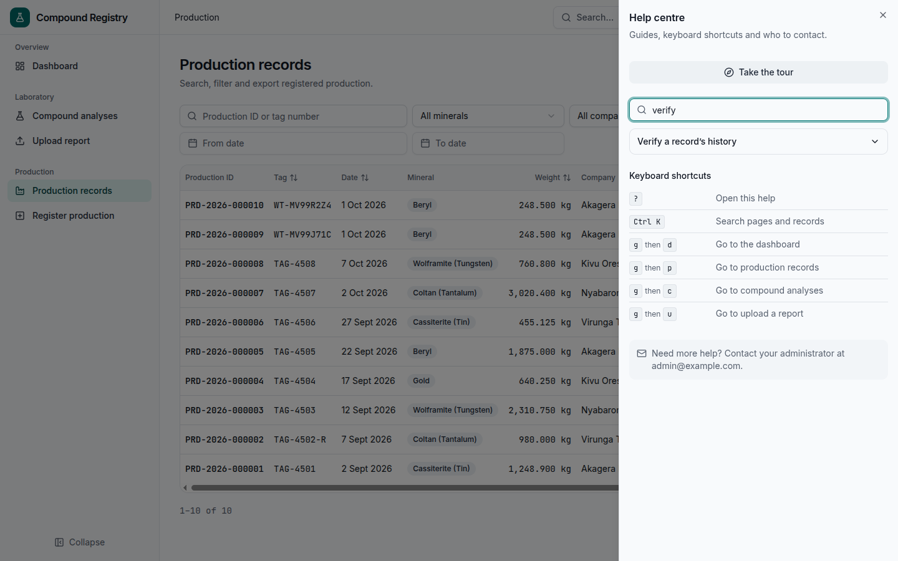

Keyboard shortcuts (not active while typing in a field):

| Keys        | Goes to                 |
| ----------- | ----------------------- |
| `?`         | Help panel              |
| `Ctrl K`    | Search                  |
| `g` then `d` | Dashboard              |
| `g` then `p` | Production records     |
| `g` then `c` | Compound analyses      |
| `g` then `u` | Upload a report        |

## Uploading and reviewing a laboratory report

1. Open **Upload report**.
2. Enter the **purchase ID** from the laboratory request.
3. Drop the report onto the upload area, or select it with **Browse**. PDF, JPG, JPEG and PNG files up to 10 MB are accepted: a PDF exported from software, a scanned PDF or a phone photo of the report all work.
4. Select **Extract values**.

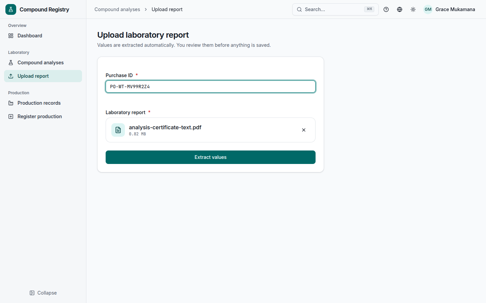

The values are read automatically. A PDF with selectable text takes a few seconds; a scan or a photo needs text recognition and can take up to a minute. The progress stages are shown while you wait.

### The review screen

Nothing is saved until you confirm. The original document is shown on the left and the values found on the right, so you can compare them line by line.

- **Confidence** — each value shows how sure the recognition is: green is high, amber is medium, red is low.
- **Needs review** — values below 85 % confidence, or whose compound name was only approximately recognised, are pinned at the top. Correct each one, or tick **Looks correct**. You cannot save until every flagged value has been checked.
- **Not measured** — a slash, `n.d.` or `<LOD` on the report means the compound was not measured. The value stays empty, never zero.
- **Found but not saved** — values printed on the report that have no column in the Compound table (for example `Nb` or `Zr` as elements) are listed separately for information.
- Integers next to element symbols, typically atomic numbers on a laboratory seal, are always flagged so they are not saved by mistake.
- **Already uploaded** — if the same file was saved before, a warning names the purchase ID and date it was saved under, so a report is not entered twice by accident.

Select **Confirm and save**. The analysis opens with the saved values and a link to the original file.

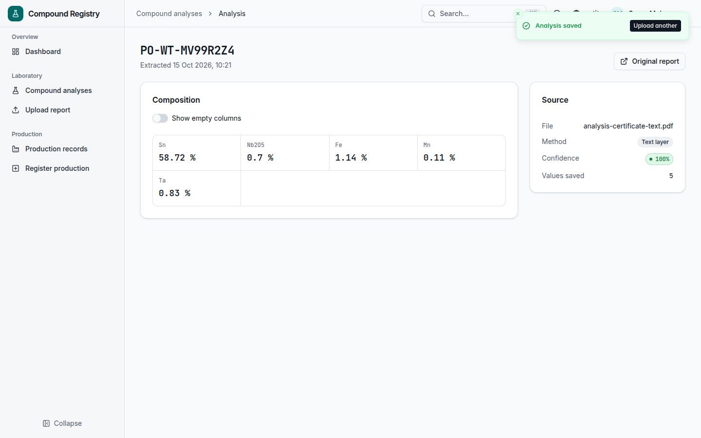

If the document is not a laboratory report — an invoice, a letter or a photo without compound values — it is refused with an explanation and nothing is stored.

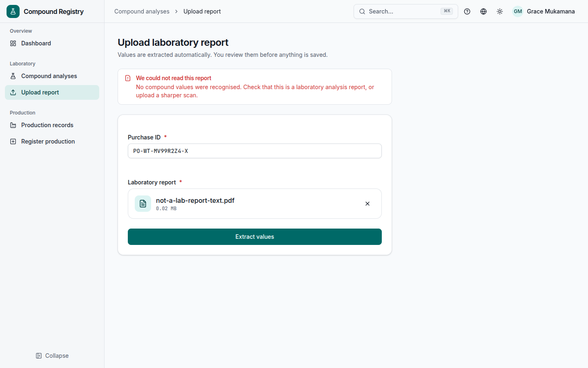

## Finding saved analyses

Open **Compound analyses**. Search by purchase ID or filter by date, then open a row to see its values and download the original report.

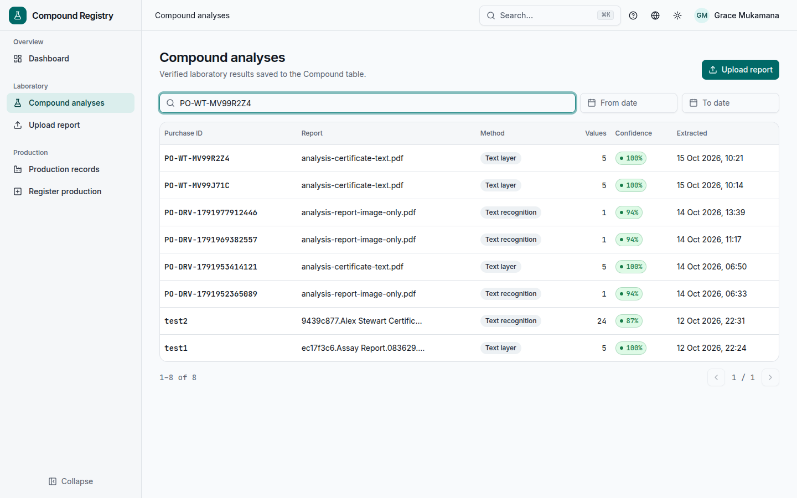

## Registering production

1. Open **Register production**.
2. Enter the **tag number** and pick the **production date**. Future dates cannot be chosen.
3. Choose the **mineral type**, **company**, **business location** and **traceability agent**. Each list can be searched by typing.
4. Enter the **weight** in kilograms: greater than zero, with up to 3 decimals.
5. Enter the **operator representative**.
6. Select **Register**.

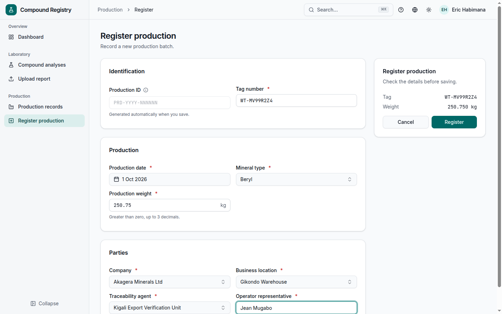

The production ID (`PRD-year-number`) is generated automatically. Double-clicking **Register** does not create a duplicate, and a tag number can only be registered once.

## Correcting a production record

Open the record and select **Edit**.

- Changes to the **tag number**, **weight**, **mineral type** or **production ID** require a **reason** of at least five characters. The reason is stored in the record's history and shown to auditors, so describe what happened (for example *Re-weighed on the certified warehouse scale*).
- Other fields, such as the representative, can be changed without a reason.
- If someone else saved the record while you were editing, your changes are not saved over theirs: select **Load latest version** and make your change again.

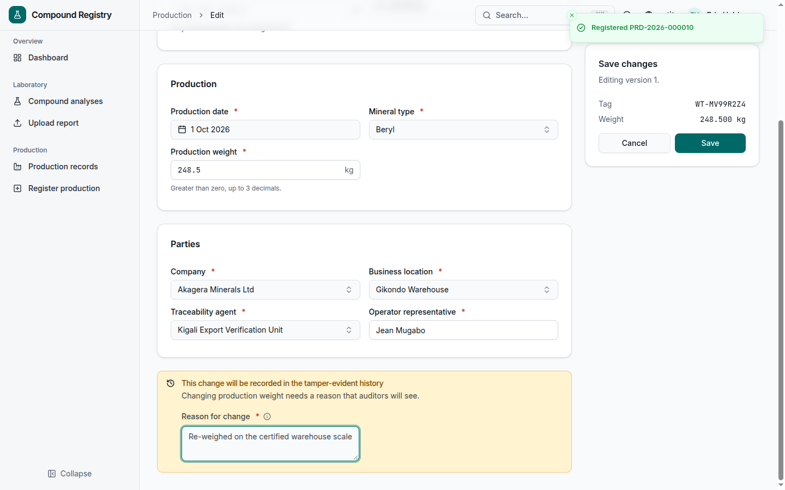

## Checking a record's history

Every production record has a **change history** listing each change to its ID, tag number, weight and mineral type: the old and new values, who made the change, when, and why.

Select **Verify integrity** to recalculate the fingerprint of every history entry and compare it with the record as it is stored now.

- **History intact** — nothing has been altered since it was recorded.
- **Tampering detected** — the history or the record was changed outside the application. The first problem found is named. Report it to your administrator straight away and do not correct the record yourself.

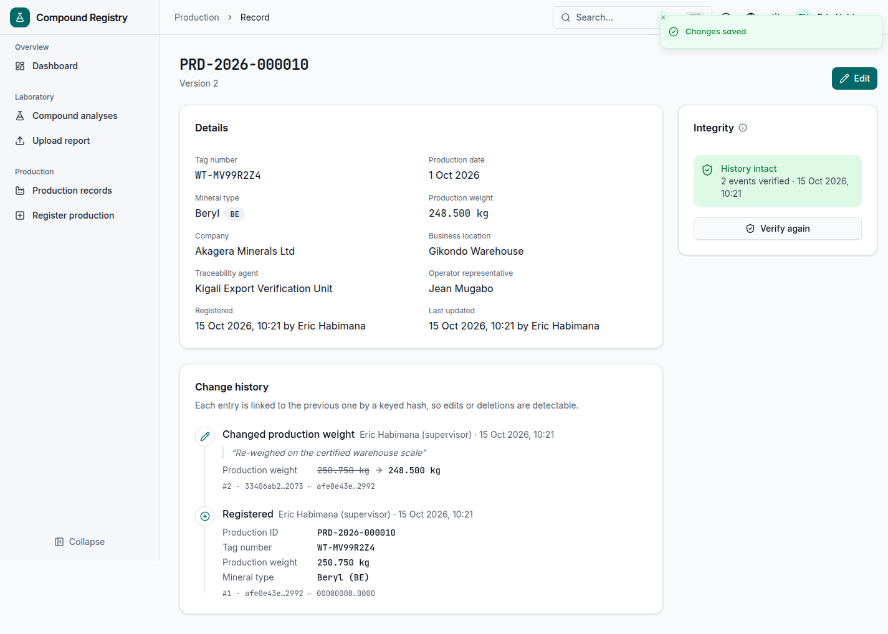

The dashboard runs the same check across every record.

## Searching and exporting production records

Open **Production records**.

- Search by production ID or tag number.
- Filter by mineral, company, location and date range; sort by any column. **Clear filters** resets them.
- Select **Export CSV** to download the records that match the current search and filters. The file opens in Excel, LibreOffice or any spreadsheet program.

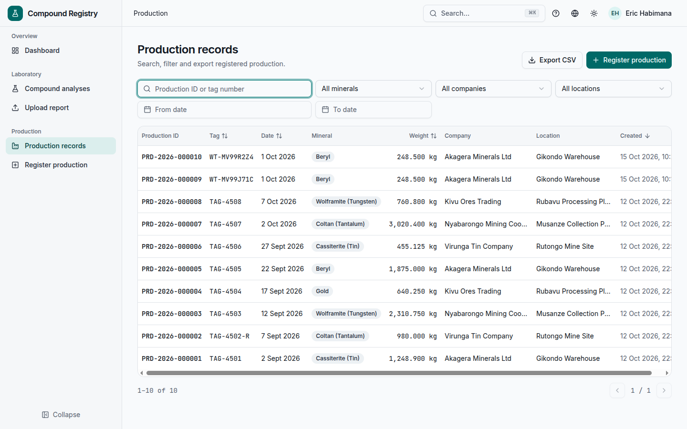

## Administration

Administrators see an **Administration** section in the sidebar.

### Users

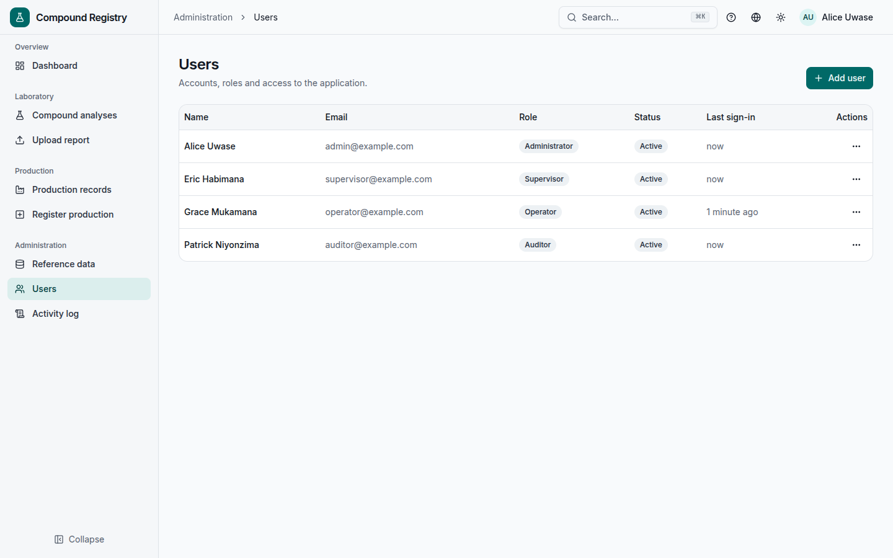

- **Add user** — enter the name, email and role. A temporary password is shown **once**; give it to the person securely. They must change it at first sign-in.
- **Change role** — takes effect on the person's next request.
- **Disable** — signs the person out at once. Their records and history are kept, and the account can be enabled again.
- **Reset password** — issues a new temporary password.
- The last active administrator cannot be disabled or demoted, and you cannot disable your own account.

### Reference data

Companies, business locations, traceability agents and mineral types used in the production form.

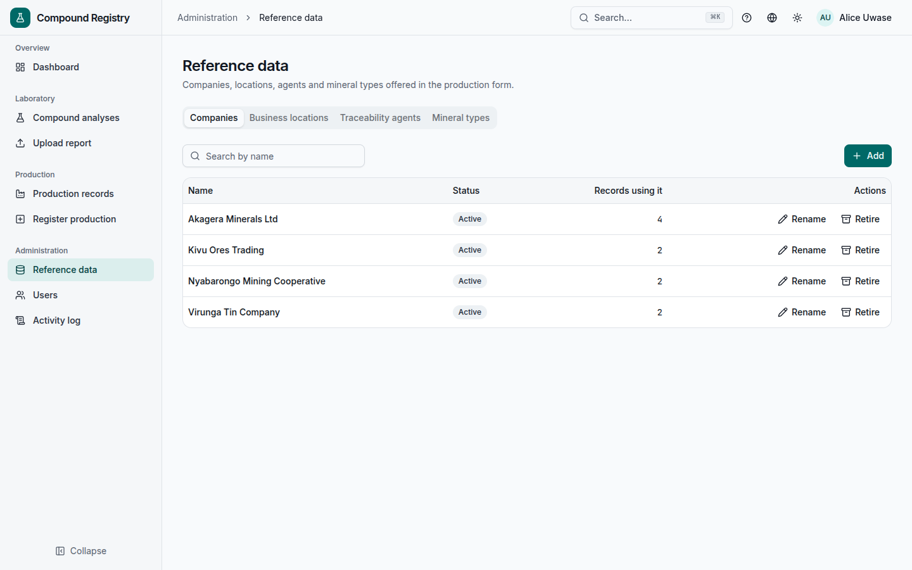

Add, rename, **retire** or reactivate an entry. The number of records using each entry is shown. A retired entry disappears from the registration form but stays on existing records.

### Activity log

Every change to users and reference data, with who made it, when, and the values before and after. Filter by action and type.

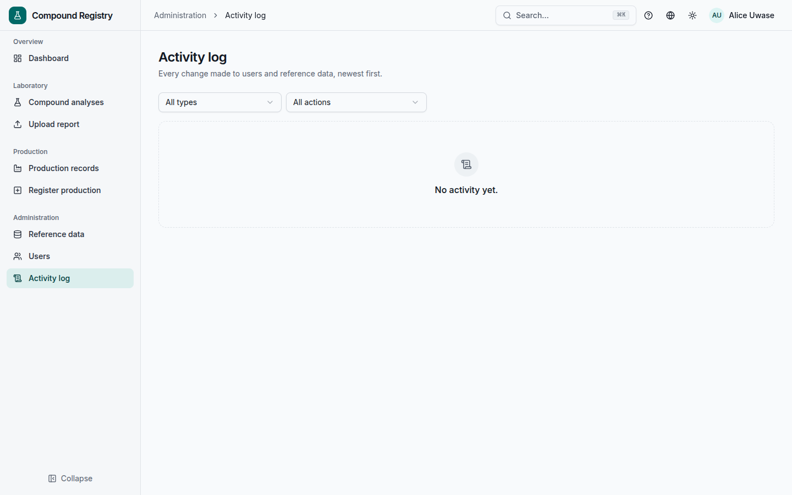

## Settings, language and theme

Open **Settings** from the account menu.

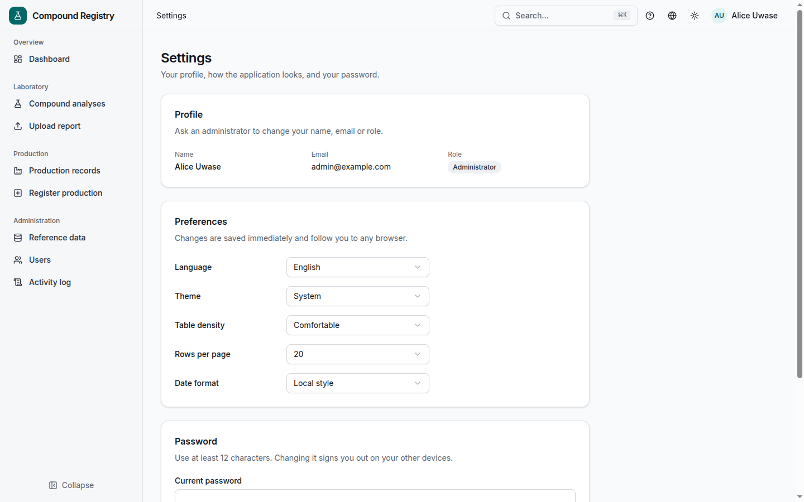

- **Password** — change your password. Other devices where you are signed in are signed out.
- **Language** — English or French. Also available from the globe button in the top bar. Numbers and dates follow the language.
- **Theme** — light, dark or follow the system.
- **Table density**, **rows per page** and **date format**.

Your preferences are saved with your account and follow you to any browser.

## Using a phone or tablet

Every screen works on a phone. The sidebar becomes a menu behind the **☰** button in the top bar, tables become cards, and a report photographed with the phone can be uploaded straight from the upload page.

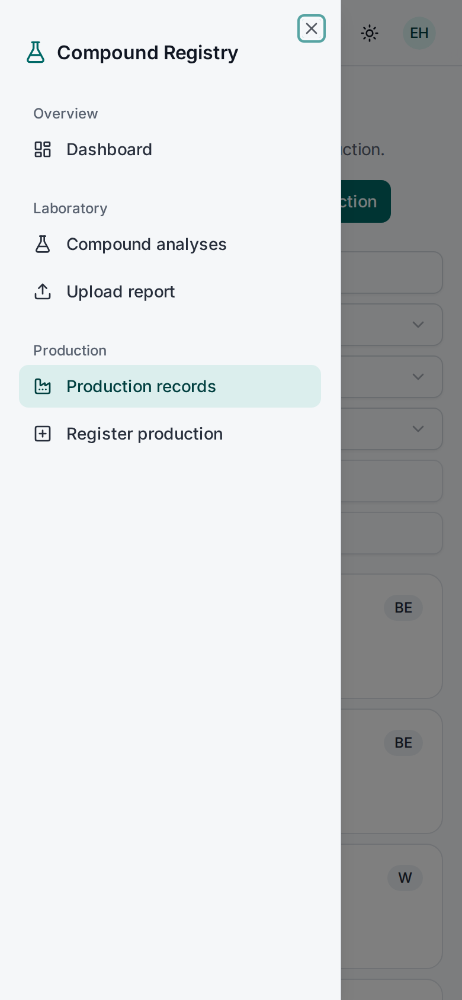

## Troubleshooting

| Message or problem                                         | What to do                                                                                                   |
| ---------------------------------------------------------- | ------------------------------------------------------------------------------------------------------------ |
| *Email or password is incorrect.*                          | Check the email address and Caps Lock. After several attempts wait a minute. Ask an administrator to reset your password if needed. |
| *This account is disabled.*                                | Contact your administrator.                                                                                  |
| *Only PDF, JPG, JPEG and PNG files are supported.*         | Save or export the report in one of these formats.                                                           |
| *The file is larger than the allowed upload size.*         | Use a smaller photo or scan at a lower resolution (300 DPI is enough).                                       |
| *This file is a … but its name ends in …*                  | The file was renamed. Upload the original file.                                                              |
| Many values flagged on a photo                             | Retake the photo straight on, in good light, filling the frame with the table, and upload again.             |
| *This extraction has expired.*                             | The review screen was left open too long. Upload the report again.                                           |
| *This tag number is already registered.*                   | Search for the tag number: the batch is already recorded.                                                    |
| *Someone else changed this record while you were editing.* | Reload the record to see their change, then apply yours again if it is still needed.                         |
| *Tampering detected*                                       | Do not edit the record. Report it to your administrator with the production ID.                              |
| *Your session has ended.*                                  | Sign in again. Unsaved changes on the open form are lost.                                                    |

For anything else, open the help panel (**?**) for your administrator's contact details.
